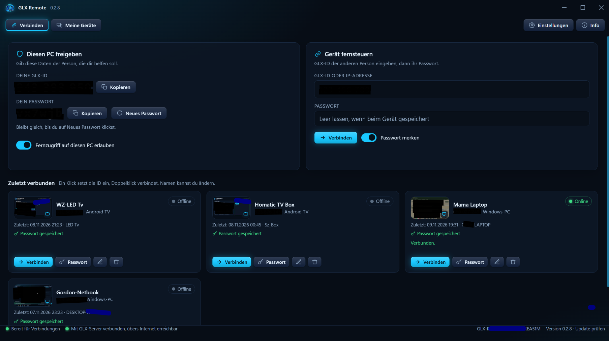
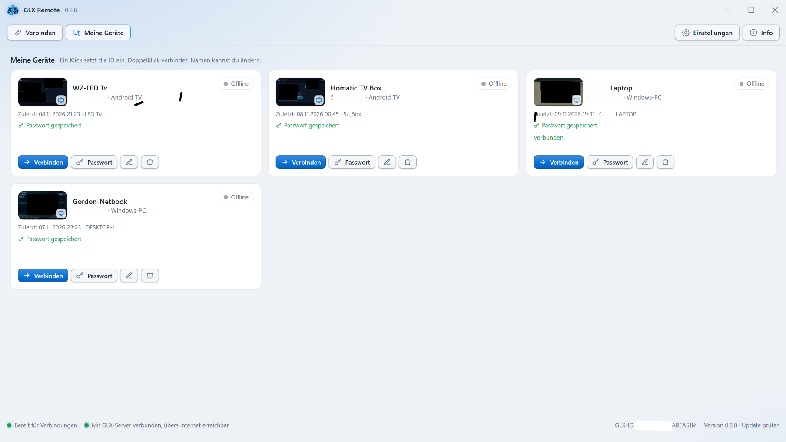

🌍 Sprachen: [🇺🇸 English](README.md) | [🇩🇪 Deutsch](README.de.md)

# 💠 GLX Remote Windows

### Fernwartung, die einfach funktioniert.

*Windows-PCs, Android-Handys und Android-TV-Geräte sehen und steuern, Dateien senden, chatten und sprechen, im eigenen Netzwerk oder über das Internet.* ⚡

   

---

## ⬇️ Download

👉 Neueste Version: [Releases](../../releases/latest)  
👉 Shop und Lizenzen: [glx-tools.de](https://glx-tools.de/product/glx-remote-windows/)

---

## 📸 Überblick & Screenshots

### 1️⃣ Hauptfenster

### 2️⃣ Ansicht 2

---

## ✨ Funktionen

- 🚀 **Fremde PCs sehen und steuern:** Maus und Tastatur funktionieren, als würdest du vor dem anderen PC sitzen, mit mehreren Monitoren, angepasster oder Originalgröße und Vollbild.
- 🧩 **Flüssiger Videostream:** Der Bildschirm kommt als H.264-Video mit bis zu 30 Bildern pro Sekunde und passt sich selbst an die Leitung an. Bei Bedarf wird auf Einzelbilder umgeschaltet.
- ⚙️ **Admin-Abfragen und Sperrbildschirm:** Ein kleiner Windows-Dienst lässt den Helfer Admin-Abfragen, den Sperrbildschirm und Programme mit erhöhten Rechten bedienen, wie bei kommerziellen Tools.
- 🔒 **Android-Handys und Android TV:** Hilfe auch auf Android-Handys und TV-Boxen. TV-Sitzungen zeigen eine Fernbedienung, die wie die echte aussieht, mit Tasten für Netflix, YouTube und mehr.
- 📂 **Dateien, Chat und Sprache:** Ordner auf dem anderen PC durchsuchen, Dateien hoch- und herunterladen, in der Seitenleiste chatten und über Mikrofon und Lautsprecher sprechen, ganz ohne Telefon.
- ⚡ **Ausschneide-Werkzeug mit Stiften:** Einen Bereich aufnehmen, mit Pfeilen, Rahmen, Textmarker, freiem Stift und Text markieren und direkt in Dokumente speichern.
- 🎨 **Tastenkombinationen per Klick:** Alt+Tab, Windows-Taste, Win+R, Win+E, Task-Manager und mehr über die Sitzungsleiste an den anderen PC senden.
- 🌍 **Meine Geräte und unbeaufsichtigter Zugriff:** Jeder PC, mit dem du verbunden warst, wird mit deinem eigenen Namen gemerkt. Passwörter werden verschlüsselt gespeichert, und eigene Computer verbinden ohne Bestätigung.
- 🛠️ **Sichere Verbindungen:** GLX-ID und Passwort für jede Sitzung, Bestätigung auf der anderen Seite, Sperre nach fünf falschen Passwörtern, verschlüsselte Verbindung über das Internet.
- 📊 **12 Designs, zwei Sprachen:** Von GLX Neon bis Hoher Kontrast, Deutsch und Englisch, Einstellungen exportieren und importieren, Updates mit einem Klick.

---

## 🧩 Systemanforderungen

- Windows 10 oder Windows 11 (64-Bit)
- Microsoft Edge WebView2 (in aktuellen Windows-Versionen enthalten)

---

## 🧪 Testzeitraum & Lizenz

14 Tage kostenlos und voll nutzbar, danach einmalige Lizenz über [glx-tools.de](https://glx-tools.de), kein Abo. Die Menschen, denen du hilfst, nutzen den kostenlosen GLX Remote Client oder GLX Remote Quick.

---

## 🔐 Datenschutz

Gespeicherte Passwörter werden von Windows verschlüsselt und bleiben auf deinem PC. Internetverbindungen sind Ende-zu-Ende-verschlüsselt.

---

## 🔗 Mehr zu diesem Produkt

👉 [glx-tools.de](https://glx-tools.de/product/glx-remote-windows/)  
Support: **info@glx-tools.de**

---

## 📄 Lizenz

Copyright © 2026 GLX Tools – Gordon Lehmann. Alle Rechte vorbehalten.  
Dies ist proprietäre kommerzielle Software. Es wird keine Open-Source-Lizenz gewährt. Dieses Repository enthält nur Release-Downloads und Dokumentation; der Quelltext wird nicht veröffentlicht.

---

Mit ❤️ gemacht von **Dreamdancer100**

