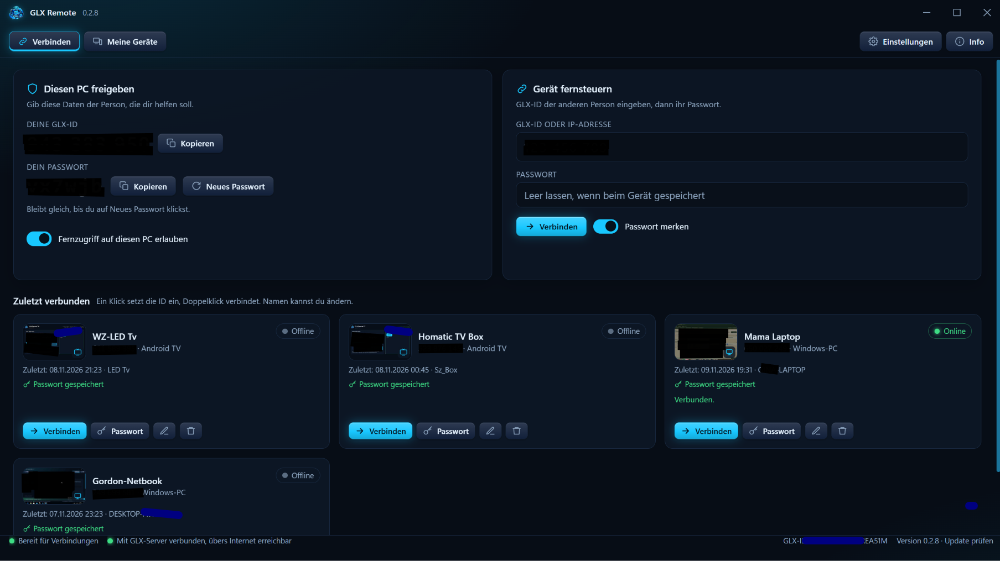
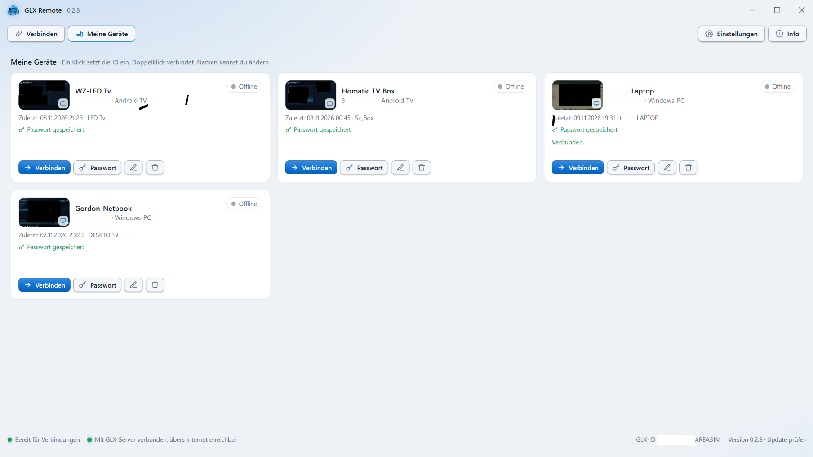

🌍 Languages: [🇺🇸 English](README.md) | [🇩🇪 Deutsch](README.de.md)

# 💠 GLX Remote Windows

### Remote support that simply works.

*See and control Windows PCs, Android phones and Android TV devices, send files, chat and talk, in the same network or over the internet.* ⚡

   

---

## ⬇️ Download

👉 Latest version: [Releases](../../releases/latest)  
👉 Shop and licences: [glx-tools.de](https://glx-tools.de/product/glx-remote-windows/)

---

## 📸 Overview & Screenshots

### 1️⃣ Main window

### 2️⃣ View 2

---

## ✨ Features

- 🚀 **See and control remote PCs:** Mouse and keyboard work as if you were sitting in front of the other PC, with multi-monitor support, fit or original size and full screen.
- 🧩 **Smooth video stream:** The screen is sent as H.264 video with up to 30 frames per second and adapts to the line by itself. Falls back to single pictures if needed.
- ⚙️ **Admin prompts and lock screen:** A small Windows service lets the helper click admin prompts, the lock screen and elevated programs, like with commercial tools.
- 🔒 **Android phones and Android TV:** Help on Android phones and TV boxes too. TV sessions show a remote control that looks like the real one, with keys for Netflix, YouTube and more.
- 📂 **Files, chat and voice:** Browse folders on the other PC, upload and download files, chat in a side bar and talk over microphone and speakers without a phone.
- ⚡ **Snip tool with pens:** Capture an area, mark it with arrows, frames, highlighter, free pen and text, and save it straight to Documents.
- 🎨 **Key combinations with one click:** Send Alt+Tab, Windows key, Win+R, Win+E, Task Manager and more to the other PC from the session bar.
- 🌍 **My devices and unattended access:** Every PC you connected to is remembered with your own name. Passwords are saved encrypted, and own computers connect without confirmation.
- 🛠️ **Secure connections:** GLX ID and password for every session, confirmation on the other side, lock after five wrong passwords, encrypted connection over the internet.
- 📊 **12 designs, two languages:** From GLX Neon to High contrast, German and English, settings export and import, one-click updates.

---

## 🧩 Requirements

- Windows 10 or Windows 11 (64-bit)
- Microsoft Edge WebView2 (included in current Windows versions)

---

## 🧪 Trial & License

Free and fully usable for 14 days, then a one-time licence at [glx-tools.de](https://glx-tools.de), no subscription. The people you help use the free GLX Remote Client or GLX Remote Quick.

---

## 🔐 Privacy

Saved passwords are encrypted with Windows and stay on your PC. Connections over the internet are end-to-end encrypted.

---

## 🔗 More about this product

👉 [glx-tools.de](https://glx-tools.de/product/glx-remote-windows/)  
For support: **info@glx-tools.de**

---

## 📄 License

Copyright © 2026 GLX Tools – Gordon Lehmann. All rights reserved.  
This is proprietary commercial software. No open-source license is granted. This repository contains release downloads and documentation only; the source code is not published.

---

Made with ❤️ by **Dreamdancer100**

